# Wintermark Magic Chests

**Craft with the items in your chests, like Enshrouded. A Paper plugin.**
Place Magic Chests in your base and every crafting table, furnace, smoker, blast furnace, stonecutter and smithing table nearby can use what's inside. No more running back and forth between chests.

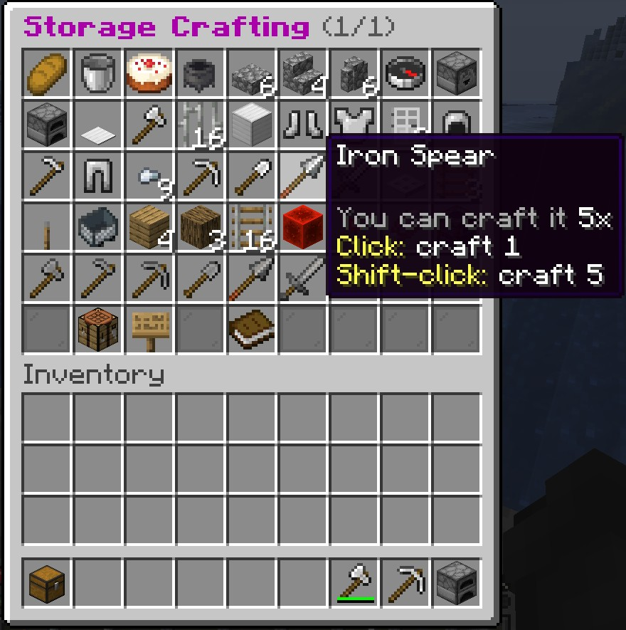

## Features

- **Magic Chests.** A craftable chest with a glow and soft particles. Crafting stations within 16 blocks can use everything inside it. Normal chests never count, so storage stays under your control.
- **Recipe book from your chests.** Open a crafting table, click a recipe in the normal recipe book and the grid fills straight from your Magic Chests. Shift-click fills up to a stack, clicking again adds one more set. Crafting stays 100% vanilla.
- **Storage Crafting menu.** Sneak + right-click a crafting table: every recipe you can make from your inventory and chests, with how many times you can craft it. Categories, search, craft 1 or craft a stack. Buckets and bottles come back like in vanilla.
- **Furnaces that feed themselves.** Sneak + right-click a furnace, smoker or blast furnace and pick what to cook. It keeps loading the item and fuel from your chests until the job is done, also while you're away, and puts the finished items back into a Magic Chest. You get a message when it's done or runs out.
- **Stonecutter and smithing table.** Pick a material or a netherite upgrade and the station opens with everything already in place. Leftover stone goes back into your chest. Your enchanted gear (inventory or chest) keeps its enchantments.
- **`/storage`.** Everything in your Magic Chests in one menu: take a stack, take 1, take as many as fit, search, sort, shift-click to store items, or store your whole inventory with one click.
- **SMP-safe.** Each Magic Chest has an owner. Only the owner and players they trust can open it or craft with it, and only the owner can break it. Explosion-proof. A Magic Chest never joins a normal chest into a double chest.
- **Items stay safe.** Renamed, enchanted and plugin items (keys, banknotes...) in your chests are never used as crafting ingredients. Items always leave the chest before they go anywhere else, so nothing can be duplicated.
- **Lightweight.** Chests are kept in a small in-memory index per chunk. Furnaces only work while their chunk is loaded. SQLite storage, no dependencies.
- **Fully configurable.** Range, recipe, fuels, amounts, every menu text and message (MiniMessage colors). New settings are added to your config automatically on updates.

| Place a Magic Chest | Anything inside it can be used |
|---|---|
| 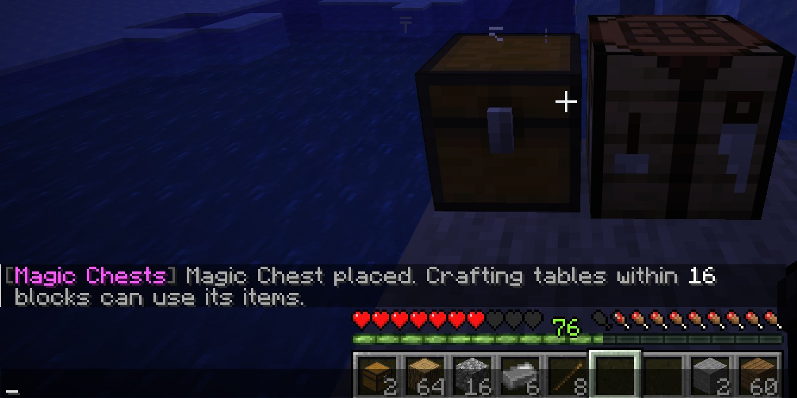 | 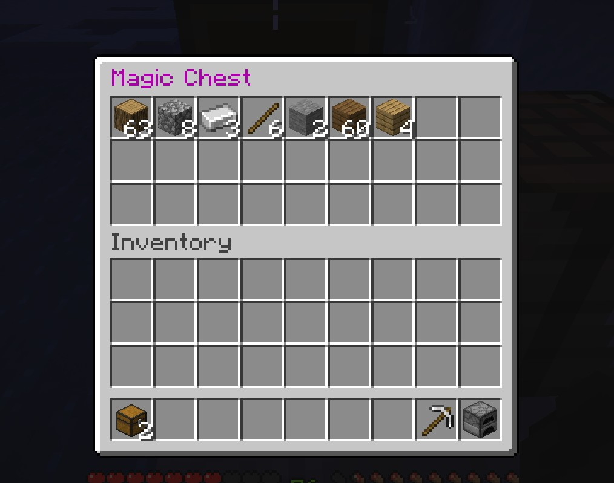 |

| Smelt from storage | The furnace keeps feeding itself |
|---|---|
| 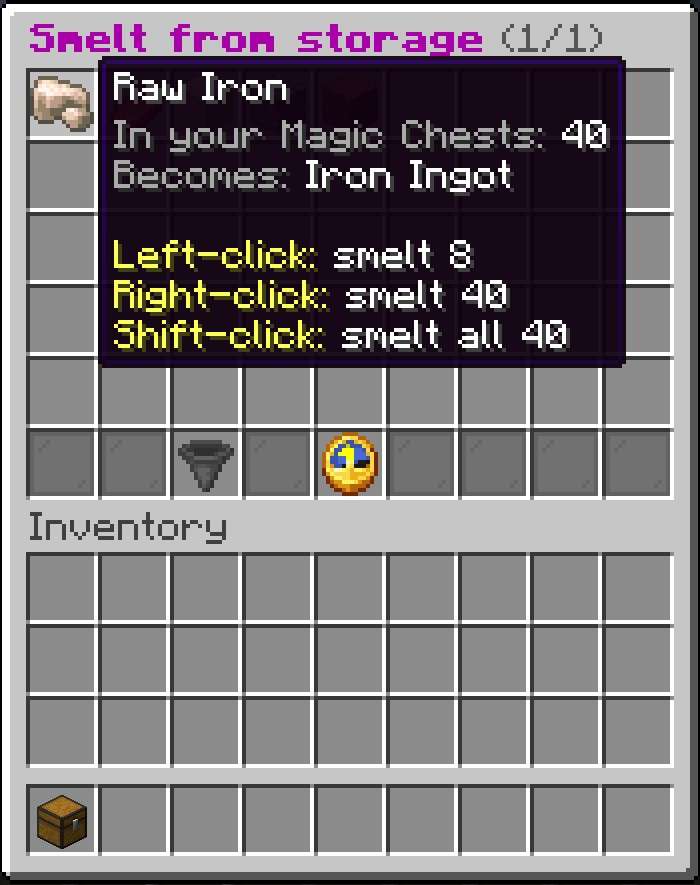 | 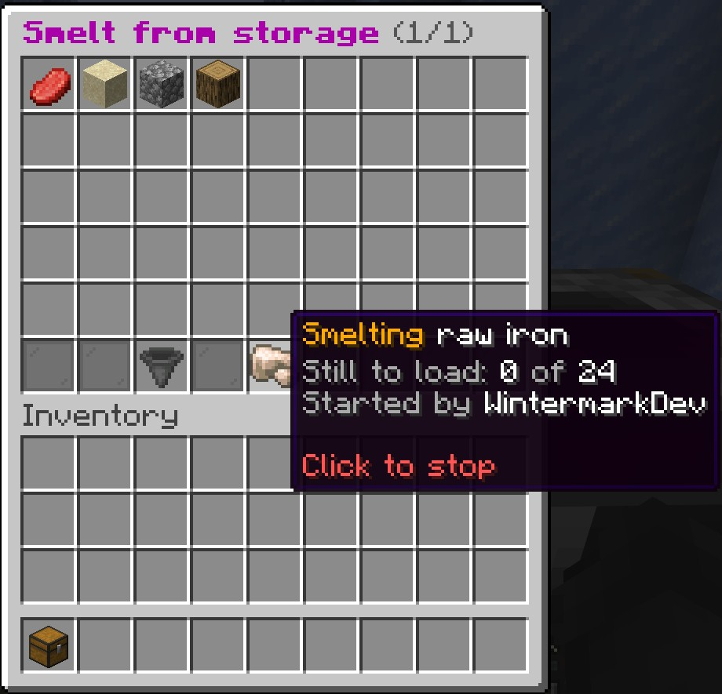 |


| Stonecutter from storage | Smithing from storage |
|---|---|
| 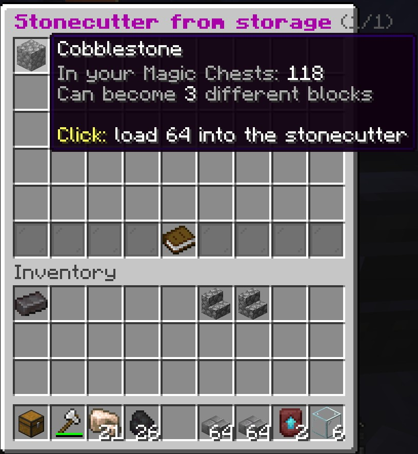 | 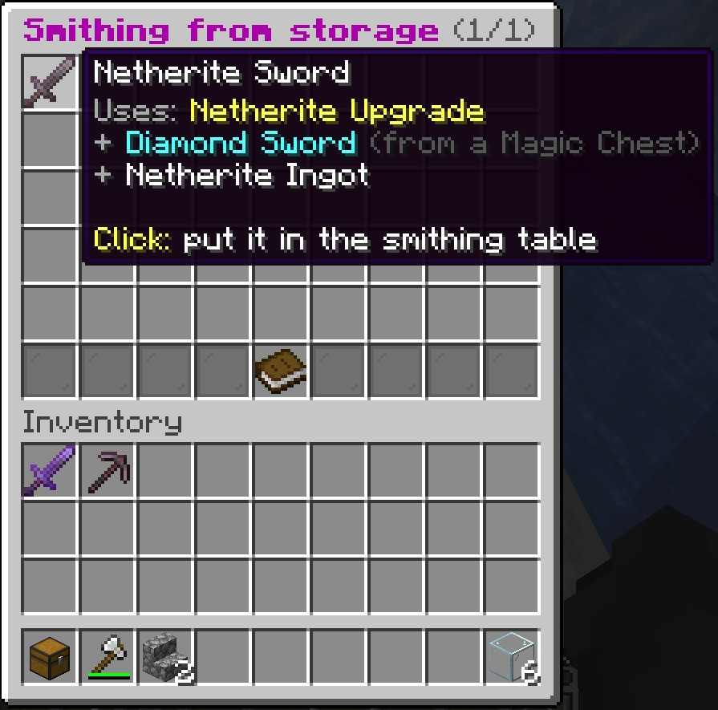 |

| Upgrade ready to take | /storage |
|---|---|
| 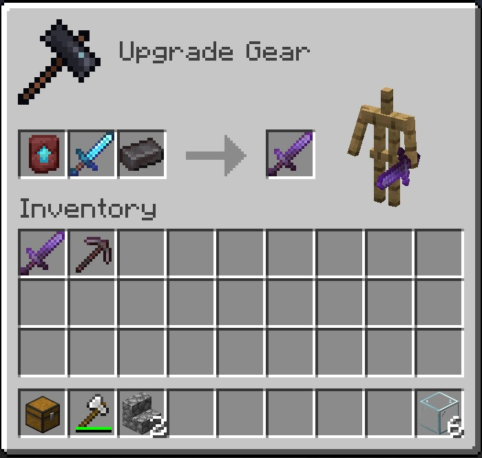 | 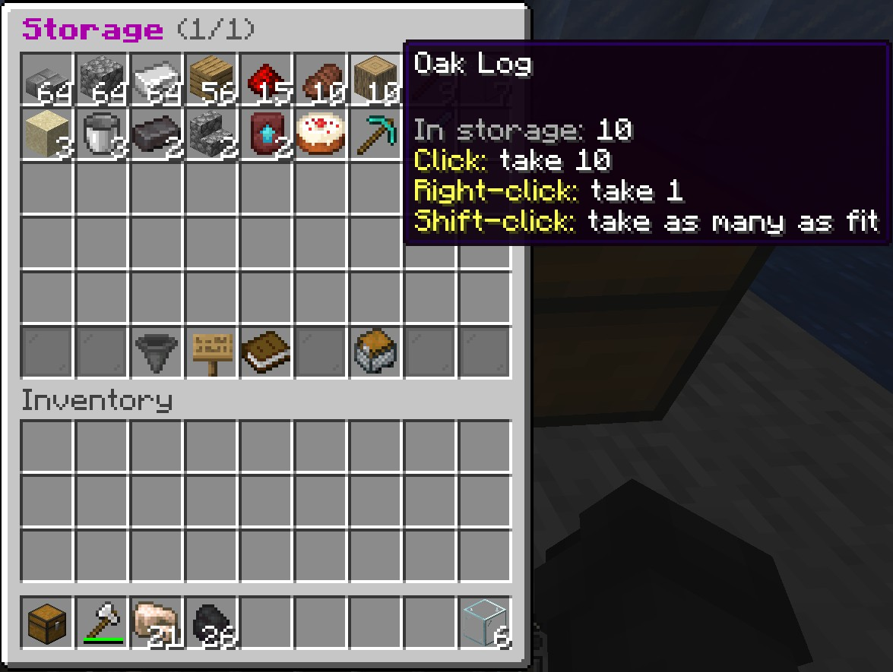 |

| Search the crafting menu | Craft your own Magic Chests |
|---|---|
| 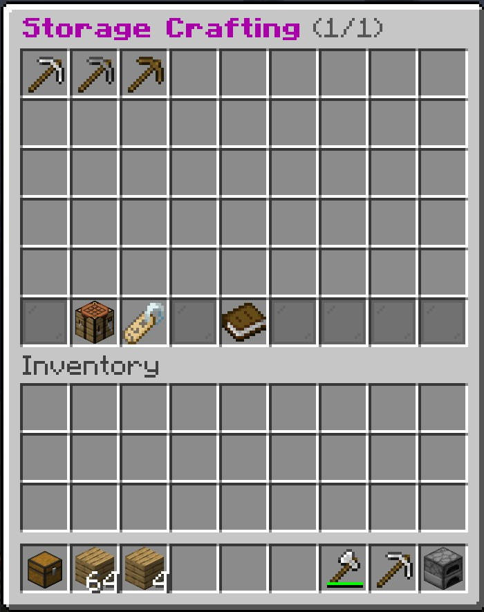 | 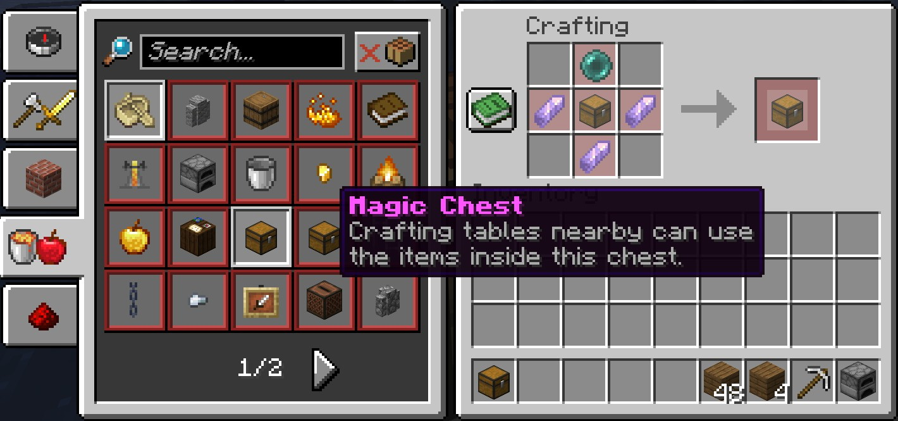 |

## How to use it

1. Craft a Magic Chest: a chest in the middle, amethyst shards left, right and below, an ender pearl on top (or `/magicchests give`).
2. Place it in your base and fill it with materials.
3. At a crafting table within 16 blocks, switch the recipe book filter to **show all recipes** and click any recipe. Or sneak + right-click the table for the Storage Crafting menu.
4. Sneak + right-click a furnace, smoker, blast furnace, stonecutter or smithing table for its "from storage" menu.
5. Type `/storage` to see and take everything at once.

Normal right-click still opens every station the normal way.

## Requirements

- **Paper 26.3** (or a Paper fork such as Purpur) with **Java 25**
- No other plugins needed
- Not tested on Folia or Spigot

## Installation

1. Download `WintermarkMagicChests-1.0.0.jar` and put it in your server's `plugins` folder.
2. Start the server. `plugins/WintermarkMagicChests/config.yml` and `magicchests.db` are created.
3. Players get the Magic Chest recipe in their recipe book when they join.

## Commands

| Command | Description | Permission |
|---|---|---|
| `/storage [search]` | Everything in your Magic Chests (alias `/magicstorage`) | `wintermark.magicchests.storage` |
| `/magicchests trust <player>` | Let a friend open and craft with your Magic Chests | `wintermark.magicchests.use` |
| `/magicchests untrust <player>` | Remove a friend | `wintermark.magicchests.use` |
| `/magicchests trusted` | Who you trust | `wintermark.magicchests.use` |
| `/magicchests list` | Where your Magic Chests are | `wintermark.magicchests.use` |
| `/magicchests info` | Owner of the Magic Chest you look at | `wintermark.magicchests.use` |
| `/magicchests give <player> [amount]` | Give Magic Chests (works from the console) | `wintermark.magicchests.admin` |
| `/magicchests reload` | Reload `config.yml` | `wintermark.magicchests.admin` |

`/magicchests` also works as `/magicchest` and `/mchest`.

**Permissions**

| Permission | Default | Description |
|---|---|---|
| `wintermark.magicchests.use` | everyone | Place Magic Chests and use them at all stations |
| `wintermark.magicchests.storage` | everyone | `/storage` for Magic Chests near you |
| `wintermark.magicchests.storage.anywhere` | nobody | `/storage` shows all your Magic Chests, wherever they are |
| `wintermark.magicchests.limit.<n>` | - | Allow up to `<n>` Magic Chests when `max-chests` is set (e.g. for VIP ranks) |
| `wintermark.magicchests.admin` | op | Give, reload, open and break every Magic Chest |

## Configuration

The default config is commented line by line. The main sections:

```yaml
range:
  horizontal: 16           # how far a station looks for Magic Chests
  vertical: 8
take-order: CHESTS_FIRST   # or INVENTORY_FIRST
only-plain-items: true     # never craft with renamed / enchanted / plugin items from chests
max-chests: 0              # per player, 0 = no limit
protect-contents: true     # only owner + trusted players can open a Magic Chest
explosion-proof: true

recipe:                    # the Magic Chest recipe (shape + ingredients)
particles:                 # type and view distance

furnace:
  output-to-chest: true    # finished items go back into a Magic Chest
  amounts: { left: 8, right: 64 }
  fuels: [COAL, CHARCOAL, COAL_BLOCK, BLAZE_ROD, DRIED_KELP_BLOCK, "#minecraft:planks", "#minecraft:logs"]

storage-command:
  range: 32

craft-menu: / smelt-menu: / stonecutter-menu: / smithing-menu: / storage-menu:   # all menu texts
messages:                  # every message
```

Text uses [MiniMessage](https://docs.advntr.dev/minimessage/format.html). Set any message to `""` to turn it off.

## FAQ

**Why do some recipes look greyed out in the recipe book?**
The game only checks your own inventory. Switch the recipe book filter to "show all", then click the recipe: the plugin fills the grid from your Magic Chests.

**Do normal chests work too?**
No, only Magic Chests, like in Enshrouded. That keeps other players' chests and loot chests safe and keeps the plugin light.

**Can my friends use my chests?**
Yes, with `/magicchests trust <name>`. They can open your Magic Chests and craft with them, but only you can break them.

**Does a furnace keep working when I log out?**
Yes, as long as its chunk is loaded (another player nearby, or a chunk loader). It continues where it stopped when the chunk loads again, also after a restart.

**Do hoppers work with Magic Chests?**
Yes, they are normal chests for hoppers.

**Where is data stored?**
`plugins/WintermarkMagicChests/magicchests.db` (SQLite): chest locations and owners, trust lists and running furnace jobs.

## Building from source

```
git clone https://github.com/wintermarkinteractive/WintermarkMagicChests.git
cd WintermarkMagicChests
./gradlew build
```

The jar is in `build/libs/`. Requires JDK 25.

## License

[MIT](LICENSE)

---

**Wintermark Interactive** - game mods, plugins and systems.
Designed, tested and maintained by Wintermark Interactive.
Custom plugins and server setups: wintermarkinteractive@gmail.com
